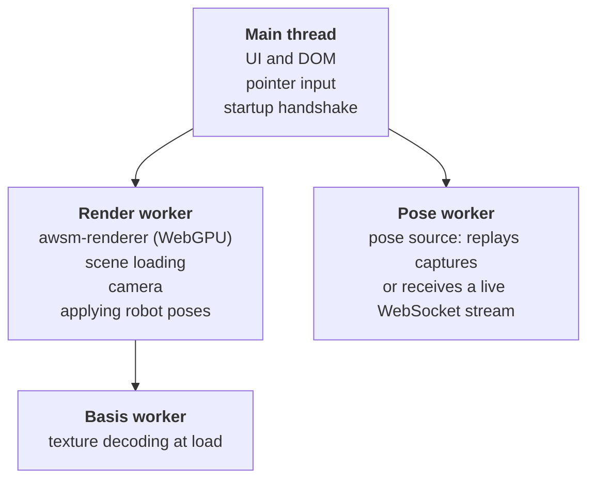
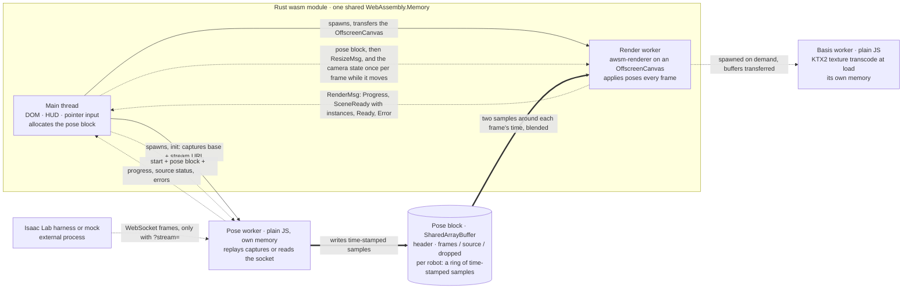

# AWSM Template
## Isaac Sim / Isaac Lab robots — w/ multithreaded rendering

_Deploys to GitHub Pages on every merge to `main`._

----
A copyable **template** from the [**Awsm**](https://awsm.fun) project: it
*plays* NVIDIA **Isaac Sim / Isaac Lab** robots, exported from their USD
assets, in [`awsm-renderer`](https://crates.io/crates/awsm-renderer), and
drives them from the outside through shared memory. Two robots ship: the
Franka **Panda** arm and the ANYbotics **ANYmal-D** quadruped, both from the
Isaac 5.0 asset library, with their Omniverse materials and textures.

Isaac Sim cannot run in a browser (it needs Linux or Windows and an RTX GPU).
So this template is the *other* end of an Isaac integration. The robots are
exported offline, authored into a scene in the [scene editor](https://scene.awsm.fun),
and moved at runtime by body poses that arrive from somewhere else:

- **Replay** (the default) loops a recorded capture per robot. The shipped
  captures are a scripted joint sweep, computed by forward kinematics over the
  robots' USD joints. It is joint animation, not physics: nothing collides and
  the quadruped does not walk.
- **Stream** (`?stream=ws://host:port`) takes live frames over a WebSocket,
  from an Isaac Lab process (`harness/isaac_lab_stream.py`) or from the mock
  that replays the captures over a socket (`task stream`).

The renderer never learns which one it is. It is the same "pose sink" as the
[`physics-mujoco`](https://github.com/awsm-fun/awsm-template-physics-mujoco)
template, minus the simulator in the page.

## Threading at a glance

### What runs where



Arrows point from a thread to the threads that work on its behalf.

### In detail

Three threads and one piece of shared state on the hot path: the pose
block. Solid arrows are spawns, dotted arrows are `postMessage` (startup,
status and input only), thick arrows are shared-memory reads/writes.



| What | Lives in | Written by | Read by | Synchronization |
|---|---|---|---|---|
| Pose block | a standalone `SharedArrayBuffer`, allocated by main once the render worker reports the scene's robots | pose worker (single writer) | render worker (single reader) | a seqlock per ring slot: the writer makes the slot's `seq` odd, writes, makes it even; the reader skips a slot caught mid-write (it never waits) |
| Rust heap | the shared `WebAssembly.Memory` main + render attach to | each thread, its own data | each thread, its own data | no app state crosses through it — it is what lets one wasm module run on both threads |

After the startup handshake, poses go pose worker → pose block → render
worker with no messages. More in [How it's wired](#how-its-wired) below.

### Timing

Every pose sample carries the time it is to be shown at, on the clock all the
page's threads share (`performance.timeOrigin + now`). Each frame the render
worker shows every robot at that frame's own time, blending the two samples
around it, so motion is paced by the display alone: how evenly the pose
worker's timers fire or the network delivers never shows.

- **Replay** publishes each capture frame stamped with when it is due on the
  loop's timeline, a little ahead of time. The recorded motion is sampled
  exactly at each display frame, with no added latency.
- **Stream** maps each frame's `step × dt` onto the page clock by the
  least-delayed recent arrivals, then adds a playout delay of 2.5 steps (83 ms
  at 30 Hz) so ordinary network jitter never leaves the renderer short. If the
  stream stalls past that, the robots hold their newest pose; nothing is
  extrapolated.
- **Camera**: the main thread owns the orbit camera and, once per frame while
  it moves, sends its state stamped with that frame's time. The render worker
  uses the state from main's *previous* frame, so every drawn frame gets
  exactly one frame of camera movement (applying pointer events as they
  arrived raced the two threads and made orbiting judder). One frame of
  latency.

## Run it

```sh
task dev   # trunk serve on http://127.0.0.1:9000 (COOP/COEP enabled)
           # + a side media server on :9001
```

Besides the usual Rust-wasm toolchain (`task`, `trunk`, nightly via
`rust-toolchain.toml`), building needs a **wasm-capable clang** for the
renderer's meshopt C++ decode path. Apple's clang has no wasm backend, so on
macOS `brew install llvm` (the Taskfile finds the Homebrew path). Linux distro
clang works as-is.

Open it in a browser with **WebGPU** and **`SharedArrayBuffer`** (recent
Chrome/Edge). Drag to orbit, wheel to zoom.

The **Stats** button (bottom left) opens a small panel (top right) with one
group per thread, each number under the thread that spent it, with its unit
and what it is per:

| Group | Headline | Rows when expanded |
|---|---|---|
| `frame budget` | the refresh period and the headroom left by the largest lane (`16.7 ms (60 Hz) · headroom 9.5 ms`, or `over by …` in red) | one row per lane, `used / budget ms (n%)`: `GPU`, `renderer (render worker)`, `page (main thread)`; then `latency (renderer + GPU), reference only` |
| `display` | refresh rate · fps | refresh rate (measured on the main thread, since no browser API reports it), frames presented, **missed frames** (refreshes that showed no new frame) |
| `GPU` | GPU time per frame (timestamp queries; `n/a` without them) | one row per pass, slowest first; on GPUs that overlap passes (Apple's) they add up to more than the frame |
| `renderer (render worker)` | the render worker's CPU time per frame | its five phases (`animations + particles`, `read app state + interpolate`, `set camera`, `update transforms`, `render (encode + submit)`); under render, awsm-renderer's own CPU scopes as `prepare` (uploads, bind groups, …), `passes` and `submit`, each scope slowest first (those under 1 µs folded into one row), then `outside the scopes` |
| `poses (replay, pose worker)` or `poses (live stream, pose worker)` | samples per second per robot | samples published, **late frames** (frames past a robot's newest sample, which held it: a stalled stream), dropped stream frames (stream only) |
| `page (main thread)` | the main thread's own work per frame | `camera frame loop` |

The simulation itself runs outside the page (or not at all, in replay), so
the pose group shows only what the page can measure: there is no step time,
and the pose worker's CPU time is not measured, so it has no frame budget lane.
Click a group to expand it; each remembers its state. Expanding a group is
what turns on its extra timing (the renderer's CPU scopes and phase clocks, the
per-pass GPU numbers), so a collapsed group, or a hidden panel, costs nothing;
an expanded one is timed on every frame. CPU and GPU work run in parallel, so
each must fit the budget on its own; they do not add up, except when the CPU
waits on the GPU, which shows as missed frames. Late frames that keep happening
turn the pose group red. The panel is off by default and remembers its state.
**Settings** (bottom right) holds the render resolution and the
anti-aliasing: Off, SMAA, MSAA 4×, TAA, or TAA upscaling from 67%, 58% or 50%
of the resolution (Quality, Balanced, Performance). TAA is the default on a
desktop; a touch device or a software GPU starts with it off (and a lower
resolution). `?aa=<mode>` (`off`, `smaa`, `msaa`, `taa`, `taa-quality`,
`taa-balanced`, `taa-performance`) picks one for a single visit without
storing it, and `?reset` forgets every stored setting. **About** (bottom
centre) says what the demo is and, on its Stats tab, what every number in the
panel means (the panel's `what do these mean?` opens it there).

Settings and Stats come from
[awsm-renderer-kit](https://github.com/awsm-fun/awsm-renderer-kit), shared by
every awsm-renderer template: its `SettingsPanel` and `StatsPanel` on the
main thread, and its stats collector and anti-aliasing switch in the render
worker. What is this app's own is in `packages/frontend/src/stats.rs` (the
frame phases and the pose group) and `packages/frontend/src/main_thread.rs`
(where the panels mount, and the words); the About modal is
`packages/frontend/src/about.rs`.

### Live stream, locally

```sh
pip install websockets
task stream                       # ws://127.0.0.1:8765, both captures at 30 Hz
task stream -- --bogus            # also sends frames for an unknown robot
```

Then open `http://127.0.0.1:9000/?stream=ws://127.0.0.1:8765`. The HUD shows
the frame rate and how many frames were dropped. Stop the producer and the
robots hold their last pose while the page reconnects. `task stream -- --plain`
sends the older wire form without step numbers, which the page also accepts.

## How it's wired

| thread | code | role |
|---|---|---|
| **Main** | `src/main_thread.rs` | DOM (Dominator), spawns both workers, brokers startup. The Settings and Stats panels are awsm-renderer-kit's; the app's stats group is `src/stats.rs`. |
| **Render** | `src/render_thread.rs` | `awsm-renderer` on an `OffscreenCanvas`. Loads the player bundle, then each frame advances the scene's clips, texture flows and particles (`update_animations`, `ParticleDriver`), blends every robot's two samples around the frame time and applies the result with `scene_loader::mujoco::apply_geom_poses` (after the clips, so the poses win). |
| **Pose worker** | `web/workers/pose-worker.js` | The pose *source*: replays captures or reads the socket, and publishes into a `SharedArrayBuffer` pose block. |

Main and render share one wasm module and one `WebAssembly.Memory` (the
threaded build: nightly, `+atomics`, `build-std`, COOP/COEP; see
`Taskfile.yml`). The pose block holds a small ring of time-stamped samples per
robot, each slot guarded by its own **seqlock**: the writer makes the slot's
counter odd, writes, makes it even, and the reader skips a slot caught
mid-write instead of blocking. The layout, the timing and the wire are
documented in `src/protocol.rs`; the camera's path in `src/camera.rs`.

### The one rule: the fingerprint

Every robot in the scene carries the SHA-256 of the root USD file it was
exported from. Every capture records it, and every stream frame starts with
it:

```text
bytes 0..32   SHA-256 of the robot's root USD, raw
bytes 32..36  u32 step number     } the stepped form (recommended): the page
bytes 36..40  f32 seconds/step    } shows each frame at step × dt on its clock
then          7 × geom_count little-endian f32: [px,py,pz,qw,qx,qy,qz] per geom
```

The plain form (no step and dt) is still accepted: each frame then counts as
one step, with dt estimated from how often they arrive.

A capture of a different file is refused with an error on the HUD. A stream
frame for a robot the scene does not contain, or of the wrong length, is
dropped and counted. Nothing is ever applied to "whichever robot is first".
Several robots share one socket.

## Bring your own robot

Everything happens in the [`awsm-renderer`](https://github.com/awsm-fun/awsm-renderer)
repo's tools and the editor; this template only plays the result. See its
[`docs/isaac.md`](https://github.com/awsm-fun/awsm-renderer/blob/main/docs/isaac.md)
for the details.

1. **Export** the USD to a sidecar and a geometry GLB:
   ```sh
   cargo run --release -p awsm-renderer-isaac-export-cli -- robot.usd -o out/
   ```
2. **Import** `out/<name>.mujoco.json` in the scene editor (MuJoCo → import
   from URL), place it, and export a **player bundle** into `media/bundle/`.
   The rest of the scene plays as authored: clips, texture flows and particles
   run, and the robots' poses are applied after them (keep clips off the
   robots' geoms: the poses own those). Anti-aliasing
   is the template's (`ANTI_ALIASING` in `src/render_thread.rs`), not the
   bundle's.
3. **Record** a capture, or stream from Isaac Lab:
   ```sh
   cargo run --release -p awsm-renderer-isaac-export-cli \
     --bin awsm-renderer-isaac-record -- robot.usd -o media/captures/
   ```
   The capture must be named after the model (`<name>.capture.json`), which
   is the default. Use the same `--variant` flags as the export, or the
   fingerprint and geom count will not match.

The shipped captures were recorded with `--amplitude 0.8` (Panda) and the
default `0.4` (ANYmal).

## Streaming from Isaac Lab

`harness/` is the sim side, in plain Python with numpy and `websockets`:

| file | what |
|---|---|
| `isaac_geom_frame.py` | Isaac Lab body poses to the geom frame the renderer takes (a copy of the renderer repo's reference). |
| `pose_stream.py` | The WebSocket server, on a background thread, that never blocks the sim loop. |
| `isaac_lab_stream.py` | The hook: construct it with the articulation, the sidecar and the root USD, then call `step()` after each `env.step`. |
| `replay_stream.py` | The mock producer behind `task stream`. |

```python
from isaac_lab_stream import IsaacLabStream

stream = IsaacLabStream(
    robot=env.unwrapped.scene["robot"],
    env_origins=env.unwrapped.scene.env_origins,
    sidecar="panda.mujoco.json",
    usd="/path/to/franka.usd",     # the same file the scene was exported from
    dt=env.unwrapped.step_dt,      # seconds per env.step: sends step + dt
).start()                          # ws://0.0.0.0:8765
while simulation_app.is_running():
    obs, *_ = env.step(policy(obs))
    stream.step()
```

What is verified: the frame builder against the exporter's fixtures, the
hook with a stand-in articulation (rest pose reproduced exactly, fingerprint
matching), and the whole wire from Python to the page with `task stream`.
What is **not** verified: running the hook inside Isaac Lab, which needs a
Linux or Windows machine with an RTX GPU.

## Deploy

`task build` writes a static site to `dist/` with relative URLs, so it works
at a domain root, a GitHub Pages project path, or a CDN subpath. Static hosts
cannot send COOP/COEP headers, so `coi-serviceworker.js` re-imposes them on
first load.

## Credits

- **Franka Panda** (Apache-2.0) and **ANYmal-D** (BSD-3-Clause, ANYbotics AG),
  converted from the NVIDIA Isaac Sim 5.0 asset library. The licenses and the
  changes made are in [`media/ASSET-LICENSES.md`](media/ASSET-LICENSES.md).
- Basis Universal transcoder (Apache-2.0), vendored at `web/vendor/basis`.

## License

MIT OR Apache-2.0, for the template's own code. The robot assets keep their
own licenses (above).
